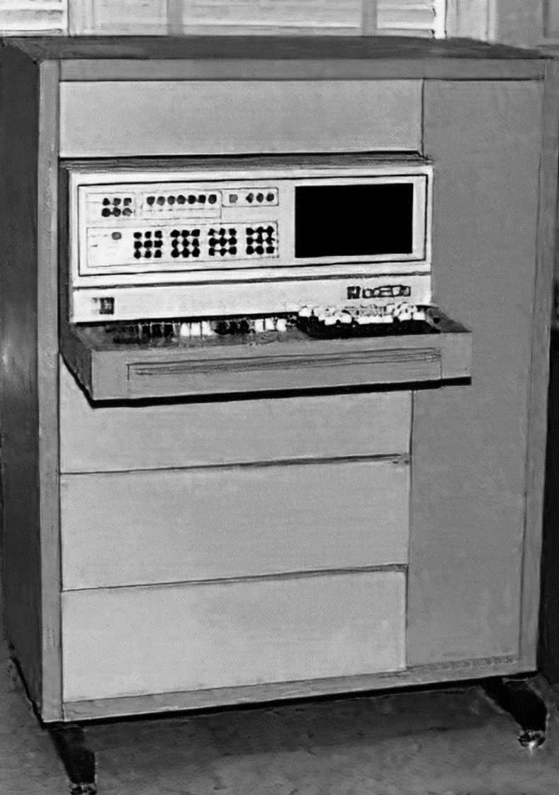
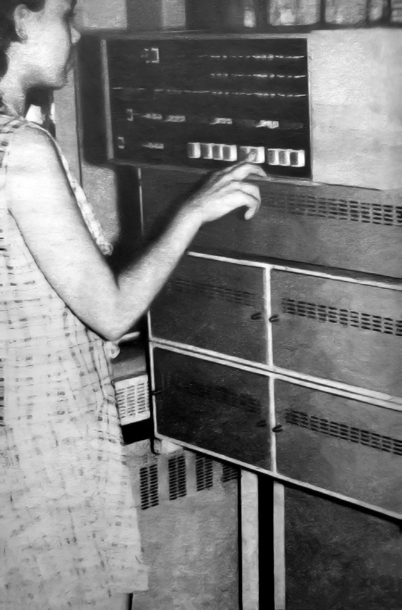
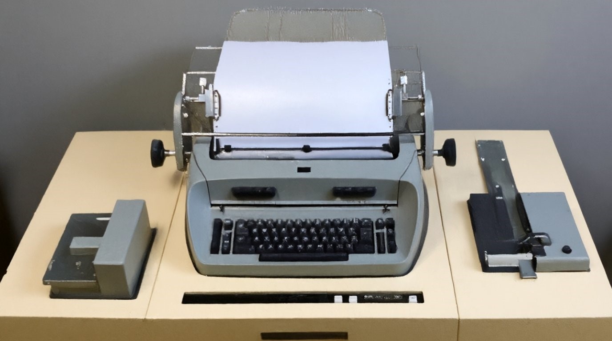
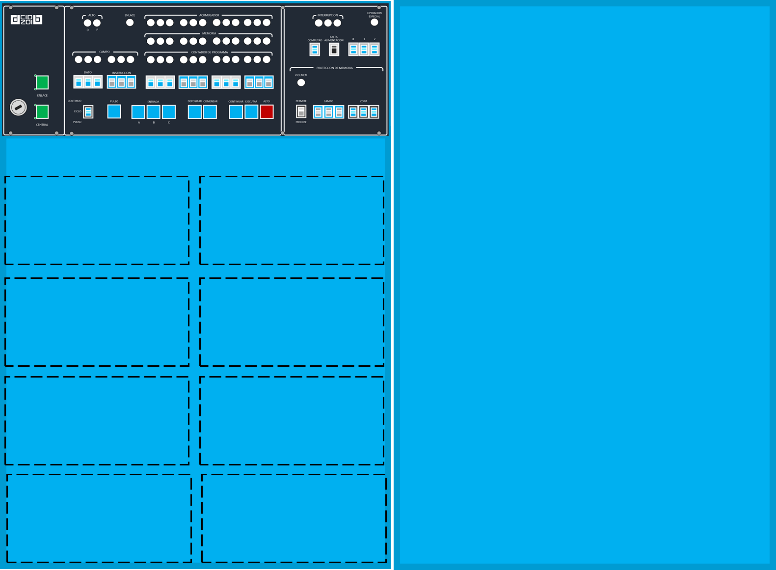

# CIDmulator-B

<p align="center"></p>

Simulador funcional, en un único archivo HTML/CSS/JS, de la minicomputadora cubana **CID 201-B** (Centro de Investigación Digital, ICID, Cuba, 1973). Reproduce su palabra de 12 bits, la memoria de ferrita modular de hasta 32 Kpalabras, el direccionamiento por campo y página, la consola física, la Unidad de Enlace y los periféricos que el emulador implementa: las teleimpresoras **Consul 260** y **Ricoh 3000**, la consola decimal **CODEC** y los puntos de entrada/salida **X, Y y Z**. Inicia con varios programas de ejemplo precargados.

[](CID201B_17.html)
[]()
[](#)
[](CID201B_17.html)
[](TEST/CID201B-tests.html)

> Un homenaje ejecutable a una de las primeras computadoras diseñadas y fabricadas en América Latina, y a las personas que la concibieron, construyeron y programaron.

**Atención: este es un trabajo en progreso.** El emulador no pretende reproducir todavía la totalidad de la configuración de la máquina real. Las secciones de [Periféricos](#periféricos) y [Notas técnicas](#notas-técnicas) detallan qué está implementado y qué queda pendiente.

# CID 201-B

<p align="center"></p>


---

## Índice

1. [Inicio rápido](#inicio-rápido)
2. [Contexto histórico](#contexto-histórico)
3. [La consola](#la-consola)
4. [Arquitectura](#arquitectura)
5. [Memoria y direccionamiento](#memoria-y-direccionamiento)
6. [Repertorio de instrucciones](#repertorio-de-instrucciones)
7. [Ciclos de máquina](#ciclos-de-máquina)
8. [Periféricos](#periféricos)
9. [Monitor «Última Página»](#monitor-última-página)
10. [Programas de ejemplo y carga `.lstb`](#programas-de-ejemplo-y-carga-lstb)
11. [Ventanas auxiliares](#ventanas-auxiliares)
12. [Estructura del proyecto](#estructura-del-proyecto)
13. [Pruebas](#pruebas)
14. [Notas técnicas](#notas-técnicas)
15. [Referencias](#referencias)

---

## Inicio rápido

No requiere instalación ni dependencias. Abre el archivo **`CIDmulatorCID201B.html`** en un navegador moderno (Chrome, Firefox, Edge o Safari). O ir a este vínculo: <https://maikelsz.github.io/CIDmulatorCID201B/CIDmulatorCID201B.html>

**Primeros pasos recomendados:**

1. Gira la **llave** del panel izquierdo hacia arriba, hasta la posición **LISTA**.
2. Pulsa el botón **CENTRAL** para encender la computadora. El estado pasa a `ALTO`.
3. Pulsa **ENLACE** para alimentar la Unidad de Enlace. Sin ella, las órdenes de entrada/salida se ignoran.
4. Abre el **Consul 260**, el **Ricoh 3000** o el **CODEC** desde los iconos de la barra de estado.
5. Pulsa **ENA**, **ENB** o **ENC** para arrancar uno de los programas de ejemplo.
6. Pulsa **ALTO** para detener la ejecución.

| Tecla | Vector | Programa |
|---|---|---|
| **ENA** | `7775 = 0200` | *Shift*: rotación del acumulador |
| **ENB** | `7776 = 0400` | *Hola Mundo*: impresión en bucle |
| **ENC** | `7777 = 7600` | Monitor «Última Página» para la consola CODEC01B|

Las teclas **ENA/ENB/ENC** del CODEC usan exactamente los mismos vectores.

> **Nota:** el botón **ALT** del CODEC produce un **Alto Dinámico (`AD`)**; el **Alto de Programa (`AP`)** solo lo genera la instrucción `ALT` (`7201`) ejecutada por un programa. El programa *Eco* existe en `0600`, pero no está asignado a ninguna tecla.

---

## Contexto histórico

La **CID 201-B** fue la evolución de la **CID 201-A** dentro de la familia CID 201, diseñada por el **Centro de Investigación Digital (ICID)** de Cuba. Heredó de su predecesora la palabra de 12 bits y la filosofía de operación en serie, pero fue una reinvención arquitectónica: añadió memoria modular de ferrita, direccionamiento por campos y páginas, protección de memoria, autoindexación, interrupciones y una Unidad de Enlace capaz de atender periféricos lentos y rápidos.

El diseño comenzó hacia **1972** y la producción en serie arrancó en **1973**. La máquina se fabricó hasta **1979** y se produjeron **más de 200 equipos**; algunas fuentes citan alrededor de **250 unidades**. Fue la base de una parte importante de la informática cubana de los años setenta y ochenta, y precedió a la CID 300/10.

| Característica | Valor |
|---|---|
| Denominación | CID 201-B (201B) |
| Diseñador | ICID, Cuba |
| Tipo | Minicomputadora de tercera generación, operación en serie |
| Introducción | 1973 |
| Fabricación | 1973 – 1979 |
| Unidades | Más de 200 (algunas fuentes: ~250) |
| Longitud de palabra | 12 bits |
| Velocidad | 100 000 sumas/s |
| Memoria | Hasta 32 Kpalabras en 8 módulos de ferrita de 4 Kpalabras |
| Tecnología | DTL al inicio; después TTL de media escala de integración |
| Direccionamiento | Segmentado-paginado, con indirección, autoindexación y protección |
| E/S | Unidad de Enlace con canales multiplexor y selector |
| Sistemas operativos | SCP1, SCP2, SN2, SIDOP-201B, monitor con ensamblador, depurador y editor |
| Software | LEAL, ENSIMACC, ALGOL, FOCAL, BASIC, FORTRAN, COBOL, LEE, LINCO, LESICA, entre otros |
| Predecesora | CID 201-A |
| Sucesora | CID 300/10 |

### Una máquina modular y protegida

La memoria se organizaba en **módulos de 4 Kpalabras**; cada módulo era un **campo** de 3 bits y se dividía en **32 páginas de 128 palabras**. El programa podía seleccionar el campo de instrucciones (**RCI**) y el campo de datos (**RCD**) por separado. Esa separación permitía aislar el sistema operativo del programa de usuario, una forma primitiva pero eficaz de protección.

La protección se ejercía sobre las instrucciones `ISC`, `DEL` y `VAS` indirectas. La CPU comparaba el campo y la zona de destino con los interruptores **CAMPO** y **ZONA** del panel frontal. Si el acceso estaba prohibido, la máquina pasaba a **ALTO** y encendía el indicador **VIOLMEM**.

### La Unidad de Enlace y los periféricos

La **Unidad de Enlace** era la interfaz entre la CPU y el mundo exterior. El sistema de E/S se organizaba en dos tipos de canales:

- **Multiplexor:** para dispositivos lentos, como los teletipos.
- **Selector:** para dispositivos rápidos, con una capacidad de transferencia de unas **200 000 palabras/s**, como las cintas magnéticas.

En distintas configuraciones, la CID 201-B podía conectarse a:

- Consola decimal **CODEC 201-B**.
- **Unidad Aritmética Binaria (UAB)**, con operandos de 12, 24 y 36 bits.
- Teletipos **Ricoh 3000** (Japón) o **Consul 260** (Checoslovaquia).
- Lector rápido de cinta **FS-751** (900 caracteres/s) y después **FS-1501** (1500 caracteres/s).
- Perforador rápido **SM-6222 / DT-105S** (100 caracteres/s) y después **DT-150** (150 caracteres/s).
- Lector de tarjetas **ES-6101** (hasta 600 tarjetas/min).
- Impresora **SM-6300 / DZM-180** (180 caracteres/s).
- Casetes de datos **CM3** (2 pistas, 280 Kpalabras por casete).
- Hasta cuatro unidades de cinta magnética **SM-5302** o **TMZ1501**.
- Hasta cuatro minidiscos **SM-5400**.
- Módems para líneas télex o telefónicas.
- Videoterminal alfanumérica **CID-702**.

La configuración **BMX** de 1975 y la UAB ampliaron todavía más el alcance de la máquina. La UAB trabajaba con enteros y flotantes, disponía de instrucciones propias (`ABIAO`, `ABPPI`, `ABSNE`, etc.) y utilizaba una convención singular: la dirección del operando se colocaba en la palabra siguiente a la instrucción.

### Producción, software y aplicaciones

La CID 201-B se utilizó en la industria azucarera, en la salud, en la educación y en la administración. El software incluía ensambladores, compiladores y lenguajes de alto nivel. Los sistemas operativos permitían procesar trabajos de forma individual o por lotes, con gestión de archivos, bibliotecas y programas de servicio.

<p align="center"></p>
CID 201-B prototipo

<p align="center"></p>
CID 201-B de primera serie

<p align="center"></p>
Ensamblado de la CID 201-B por estudiantes de la Escuela Vocacional "Vladimir Ilich Lenin"

<p align="center"></p>
Consola "Ricoh-3000". Una teleimpresora y terminal de datos hecha en Japón, basada en al IBM 2741, a la que se añadió un perforador y un lector de cinta de papel.

### Qué modela este emulador

Este emulador se concentra en la **unidad central**, la **consola de mando**, la **memoria de ferrita**, el **direccionamiento por campo y página**, la **protección**, las **interrupciones** y un subconjunto de periféricos. No reproduce la UAB, la impresora DZM-180, el lector de tarjetas ES-6101, las cintas magnéticas, los minidiscos ni los casetes. Tampoco pretende ser un simulador ciclo a ciclo del hardware original: reproduce el **coste** y la **secuencia** de los ciclos, no los turnos del reloj.

---

## La consola

La consola de la CID 201-B reúne en un solo cuerpo los indicadores, los interruptores, la llave de seguridad, las teclas de control y el panel de protección.

### Panel superior

- **EN**: una lámpara para el **Registro de Enlace**, el bit de acarreo y extensión del acumulador.
- **ACUMULADOR**: 12 lámparas, agrupadas de tres en tres.
- **MEMORIA**: 12 lámparas para el Registro de Memoria (`RM`).
- **CONTADOR DE PROGRAMA**: 12 lámparas para el `CP`.
- **CAMPO**: dos grupos de tres lámparas, **DATO** (`RCD`) e **INSTRUCCIÓN** (`RCI`).
- **ALTO**: lámparas `D` (Alto Dinámico, `AD`) y `P` (Alto de Programa, `AP`).
- **INTERRUPCIÓN**: tres lámparas de estado.
- **OPERACIÓN ESPECIAL**: lámpara de operación especial.
- **VIOLMEM**: lámpara de violación de memoria.

### Panel inferior

| Elemento | Función |
|---|---|
| **Llave** | `APAGADO`, `LISTA`, `BLOQUEO`. Solo en `LISTA` se puede encender la máquina |
| **CENTRAL** | Enciende o apaga la Unidad Central de Proceso |
| **ENLACE** | Enciende o apaga la Unidad de Enlace |
| **12 interruptores** | Escriben un valor de 12 bits. Arriba = 1, abajo = 0 |
| **DATO** | Tres interruptores que forman el campo de datos de 3 bits |
| **INSTRUCCIÓN** | Tres interruptores que forman el campo de instrucciones de 3 bits |
| **CONTINUO / CICLO / PASO** | Modo de ejecución |
| **PULSO** | Avanza según el modo seleccionado |
| **ENTRADA A / B / C** | Arranca desde los vectores `7775`, `7776` y `7777` |
| **DEPOSITAR** | Escribe los interruptores en la memoria y avanza el `CP` |
| **COMENZAR** | Arma la máquina desde el `CP` actual; en `CONTINUO` arranca, en `CICLO`/`PASO` queda lista para `PULSO` |
| **CONTINUAR** | Carga el `CP` y los campos `RCD`/`RCI` desde los interruptores |
| **EJECUTAR** | Lee la memoria en `RM` y avanza el `CP` |
| **ALTO** | Detiene la máquina en Alto Dinámico |

**CONTINUAR** es la tecla que fija el vector de arranque. Toma los 12 interruptores como dirección, los tres interruptores **DATO** como `RCD` y los tres **INSTRUCCIÓN** como `RCI`; después deja el ciclo en `CI`.

**DEPOSITAR** solo actúa en estado `ALTO`. Escribe el valor de los interruptores en la dirección efectiva `[RCI:CP]`, carga ese valor en `RM` y avanza el `CP` en uno.

**EJECUTAR** solo actúa en estado `ALTO`. Lee `[RCI:CP]` en `RM` y avanza el `CP` en uno, sin modificar la memoria.

**PULSO** se comporta así:

- En **CONTINUO**, arma la máquina y entra en ejecución automática.
- En **CICLO**, ejecuta un ciclo de máquina (`CI`, `CM`, `CD`, `CO`, `CV`, `INT1` o `INT2`).
- En **PASO**, ejecuta una instrucción completa con todos sus ciclos.
- En **ALTO de Programa (`AP`)** el pulso está bloqueado.

### Protección e interrupciones

El panel de protección contiene:

- **PERMITE / PROHIBE**: interruptor global. En la barra de estado se muestra como `PROT: PERM` o `PROT: PROH`.
- **CAMPO**: tres interruptores de tres posiciones que fijan el patrón de 3 bits del campo.
- **ZONA**: tres interruptores de tres posiciones que fijan el patrón de 3 bits de la zona.
- **VIOLMEM**: se enciende cuando se detecta un acceso prohibido.

Cada interruptor de tres posiciones representa un bit del patrón, del más significativo al menos significativo:

| Posición mostrada | Significado |
|---|---|
| `1` | El bit debe valer 1 |
| `~` | El bit no importa |
| `0` | El bit debe valer 0 |

El campo o la zona del acceso se compara con el patrón completo. Si algún bit no coincide, el acceso está prohibido. Por ejemplo, `CAM: 1~0` exige que el campo tenga el bit 2 a 1, el bit 0 a 0 y el bit 1 libre (campos 4 y 6). No es «un interruptor por módulo»: los ocho campos y las ocho zonas se seleccionan con el patrón.

Cuando el interruptor global está en **PERMITE**, la comprobación se omite por completo; en **PROHIBE** se aplican los patrones de campo y zona. La comprobación se realiza en los accesos indirectos `ISC`, `DEL` y `VAS`, como indica el manual de 1978.

Cuando se produce una violación, la máquina se detiene, enciende `VIOLMEM` y pasa a `ALTO`. El tipo de alto depende de la configuración de interrupciones: `AP` si las interrupciones están habilitadas y `AD` si no lo están.

El interruptor **COMPUTAD** tiene tres posiciones:

- **Superior:** acepta interrupciones siempre.
- **Media:** acepta interrupciones solo si el programa las habilitó con `CIN`.
- **Inferior:** no acepta interrupciones.

Las instrucciones `CIN` (`7660`) y `DIN` (`7650`) habilitan y deshabilitan las interrupciones. `LIG` (`7002`) también limpia la interrupción pendiente.

> **Limitación:** los interruptores **FALTA ALIMENTACIÓN** y la lámpara **OPERACIÓN ESPECIAL** están presentes en el panel, pero no están cableados a ningún comportamiento. La función `triggerPowerFailure()` existe, pero no se invoca desde la interfaz.

### Barra de estado

La barra inferior muestra, de izquierda a derecha:

1. **Reset `⟲`**.
2. `EN`, `AC`, `RM`, `CP`, `RCD`, `RCI`, `RNI`, `RVI`.
3. `DATO` e `INSTR`, con el valor de sus tres interruptores.
4. `SW`, con el valor de los 12 interruptores.
5. `Ciclo`, con el ciclo actual o `AD` cuando la máquina no está armada.
6. `PROT`, `CAM` y `ZON`.
7. `Modo`: `CONTINUO`, `CICLO` o `PASO`.
8. `Vel`: botones `1`, `10`, `100` y `MAX`, con la velocidad efectiva.
9. `Estado`: `APAGADO`, `ALTO (AD)`, `ALTO (AP)` o `EJECUTA`.
10. Iconos de **cargar `.lstb`**, **Ricoh**, **Consul**, **CODEC**, **mapa de memoria** y **ayuda**.

`AD` y `AP` son **tipos de alto**, no ciclos normales. Por eso la barra muestra `Ciclo: AD` cuando la máquina está detenida y `CI`, `CM`, `CD`, `CO`, `CV`, `INT1` o `INT2` cuando está armada.

### Teclado físico

El teclado del navegador se dirige al periférico que esté abierto:

- Con el **Consul 260** abierto y **READY** activo, las teclas escriben en el Consul. `Shift`, `Enter`, `Backspace` y `Tab` se traducen a las teclas correspondientes.
- Con el **Ricoh 3000** abierto, las teclas escriben en el Ricoh, con el mismo tratamiento de `Shift`, `Enter`, `Backspace` y `Tab`.
- Las teclas de control de la consola (`CENTRAL`, `ENLACE`, `CONTINUAR`, `DEPOSITAR`, `EJECUTAR`, `COMENZAR`, `ALTO`, `PULSO`) se pulsan con el ratón. No hay atajos globales de teclado.

### Memoria de ferrita, encendido y reset

La memoria del emulador se comporta como una **memoria de ferrita**:

- **Apagar y volver a encender no borra la memoria.** Tampoco recarga las demos de fábrica.
- Las demos solo se cargan **al abrir la página** por primera vez.
- El botón **reset `⟲`** está en la **extrema izquierda de la barra de estado**. Solo funciona con la máquina encendida; con la máquina apagada se deshabilita.
- El reset detiene la ejecución, **inicializa la memoria con las demos de fábrica**, limpia los registros de la CPU, los punteros, los autoíndices y el estado de la Unidad de Enlace, y deja la máquina en **ALTO DINÁMICO (`AD`)**.
- El reset **conserva** la posición y el estado de los interruptores (`SW`, `DATO`, `INSTRUCCIÓN`), la llave, el modo de protección, el modo de ejecución, la alimentación de la Unidad de Enlace y los interruptores de falta de alimentación e interrupción.
- El reset **no toca** el CODEC, el Ricoh ni el Consul: son periféricos externos y pueden seguir imprimiendo.
- Un programa `.lstb` cargado **se pierde al pulsar reset**; el apagado y encendido, en cambio, lo conservan.

---

## Arquitectura

<p align="center"></p>

### Registros

| Registro | Bits | Función |
|---|---|---|
| **AC** | 12 | Acumulador. Operaciones aritméticas y lógicas; buffer de E/S |
| **EN** | 1 | Registro de Enlace: acarreo y extensión del acumulador |
| **RM** | 12 | Registro de Memoria: recibe la palabra leída |
| **CP** | 12 | Contador de Programa: dirección de la próxima instrucción dentro del campo |
| **RCD** | 3 | Registro de Campo de Dato |
| **RCI** | 3 | Registro de Campo de Instrucción |
| **RNI** | 3 | Registro Nuevo de Instrucción: campo que se usará a continuación |
| **RVI** | 3 | Registro Viejo de Instrucción: campo de origen para poder volver |
| **RI** | 6 | Registro de Instrucción (se conserva como estado de trabajo) |
| **RP** | 5 | Página actual |
| **RI1 / RI2** | — | Partes del registro de instrucción |

Solo `EN`, `AC`, `RM`, `RCD` y `RCI` son directamente accesibles al programador. `RNI` y `RVI` se manipulan con las microinstrucciones de cambio de campo y con los saltos indirectos.

> **Terminología:** en este proyecto se distingue el **Registro de Enlace (`EN`)**, que es el bit de acarreo, de la **Unidad de Enlace (`ENLACE`)**, que es la interfaz de entrada/salida. No se usa «enlace» a secas para ninguno de los dos.

### Unidad aritmética

La CPU es una máquina **serie** de 12 bits. El sumador trabaja bit a bit y el par `EN/AC` forma un registro de 13 bits que se desplaza en las rotaciones. Las operaciones lógicas (`YLO`, `ORI`) y las transferencias (`DEL`, `VAS`, `VEA`, `ISC`) no modifican el `EN`, salvo las excepciones indicadas en el repertorio.

### Unidad de Enlace

La `ENLACE` es la interfaz de E/S. Si está apagada, **todas las instrucciones del grupo `6` se ignoran**. El emulador la enciende con el botón `ENLACE` del panel.

La Unidad mantiene indicadores de lectura (`IL`), impresión (`IP`), fin de línea (`IF`), error (`IE`) y tecla (`IT`). Las instrucciones `SIL`, `SIP`, `SIF`, `SIE` y `SITE` permiten consultarlos.

### Reloj y velocidad

La máquina real ejecutaba **100 000 ciclos por segundo**. El emulador usa un temporizador de 16 ms y un acumulador de ciclos; la velocidad se puede reducir a `1`, `10` o `100` ciclos/s, o dejar en `MAX` (100 000 ciclos/s). En `MAX` el límite interno es de 20 000 ciclos por turno para no bloquear el navegador.

---

## Memoria y direccionamiento

### Organización

- **32 768 palabras** de 12 bits (`Uint16Array(32768)`).
- **8 módulos** de **4096 palabras** (4 Kpalabras).
- Cada módulo es un **campo** de 3 bits, de `0` a `7`.
- Cada campo se divide en **32 páginas** de **128 palabras**.
- Direcciones absolutas de **15 bits**, hasta `77777` octal.

### Formato de una instrucción IRM

```
bits:  0 1 2 | 3 | 4 | 5 6 7 8 9 10 11
       opcode | I | P |  desplazamiento (7 bits)
```

En la notación octal de cuatro dígitos, el primer dígito contiene el `opcode`, el segundo contiene los bits `I` y `P`, y los dos últimos son el desplazamiento.

| Bit | Nombre | Significado |
|---|---|---|
| 0–2 | `opcode` | Código de operación (0–7) |
| 3 | `I` | 0 = directo, 1 = indirecto |
| 4 | `P` | 0 = página 0, 1 = página actual |
| 5–11 | `offset` | Desplazamiento dentro de la página |

### Dirección efectiva directa

La dirección se forma con:

- **Campo:** `RCD` para operaciones de dato (`YLO`, `SUM`, `ISC`, `DEL`) y `RCI` para operaciones de instrucción (`VAS`, `VEA`).
- **Página:** la página 0 si `P = 0`; la página actual, tomada de los cinco bits altos de `CP`, si `P = 1`.
- **Desplazamiento:** los siete bits bajos de la instrucción.

```
dirección = (campo << 12) | (página << 7) | offset
```

### Direccionamiento indirecto: el puente

Cuando `I = 1`, la palabra apuntada no es el operando, sino un **puente** de 12 bits. El manual de 1978 (p. 11) lo describe como **«Puente RP + RI2»**: página de 5 bits y desplazamiento de 7 bits. El campo **no viaja dentro del puente**; se toma del registro de campo correspondiente.

```
bits:  0 1 2 3 4 | 5 6 7 8 9 10 11
       página     | offset (7 bits)
```

| Parte | Bits | Significado |
|---|---|---|
| **Página** | 5 | Página de destino dentro del campo (0–31) |
| **Offset** | 7 | Desplazamiento dentro de la página (0–127) |

La dirección absoluta de 15 bits se forma **fuera** del puente:

```
dirección = (campo << 12) | (página << 7) | offset
```

- **Campo:** `RCD` para `YLO`, `SUM`, `ISC` y `DEL`; `RCI` para `VEA(I)`; `RNI` para `VAS(I)`.
- **Página y offset:** los 12 bits del puente.

El puente cubre las **32 páginas** del campo activo, no solo las cuatro primeras. Es el mismo esquema de la PDP-8/I: palabra de 12 bits, página de 128 palabras, campos de 4 K y registros de campo de 3 bits para llegar a 32 K. La palabra indirecta de la PDP-8/I tampoco contiene el campo.

**Ejemplo:** el puente `7711` octal se descompone en página `31` y offset `111`; en el campo 0 apunta a `7711` y en el campo 3 a `37711`.

#### `VAS(I)`, `VEA(I)` y `VPP`

La tabla de la p. 13 del manual distingue los dos saltos indirectos:

- **`VAS(I)`** es la llamada entre módulos. Lee el puente en el campo actual (`RCI`), guarda ese campo en `RVI` y carga en `RCI` el campo nuevo que preparó `CCIN` en `RNI`. Después salta a la página y offset del puente, ya en el campo nuevo.
- **`VEA(I)`** es el salto indirecto dentro del campo actual. Lee el puente y salta a su página y offset sin cambiar `RCI` ni `RVI`.
- **`VPP`** (`7700`) es la vuelta entre módulos. Restaura `RCI` desde `RVI` y ejecuta un `VEA(I) 0000`: lee el puente en `0000` del campo restaurado y salta a la dirección que contiene.

La secuencia `RNI → RCI → RVI` del manual (p. 11) se aplica a `VAS(I)`: el campo nuevo pasa a `RCI` y el viejo queda en `RVI`. `VEA(I)` no la ejecuta; si la ejecutara, `VPP` no podría recuperar el campo de origen. Esta lectura es la única coherente con la tabla de la p. 13 y con el retorno entre módulos.

### Autoíndices

Las direcciones `0010` a `0017` de **cada módulo** actúan como **ocho registros autoíndices**. Cuando se usan como puente, su contenido se incrementa en uno **antes** de calcular la dirección efectiva. Hay ocho autoíndices por módulo, 64 en total. El emulador implementa este incremento en `resolveAddress()`.

### Protección de memoria

El manual (p. 14) limita la comprobación a los accesos **indirectos** de `ISC`, `DEL` y `VAS`:

- **Campo:** `RCD` en `ISC` y `DEL` indirectos; el campo nuevo de instrucción (`RNI`, que pasa a `RCI`) en `VAS` indirecto.
- **Zona:** los **tres bits más significativos del puente**, que con la página de 5 bits son los bits 4–2 de la página (grupos de cuatro páginas).

Los interruptores **CAMPO** y **ZONA** no seleccionan un módulo o una zona concreta: cada uno de los tres interruptores fija un bit del patrón. La posición `1` exige un bit 1, la posición `0` exige un bit 0 y la intermedia `~` no importa. El campo o la zona se compara con ese patrón; si algún bit no coincide, se dispara `VIOLMEM` y la máquina pasa a `ALTO`. El interruptor global **PERMITE/PROHIBE** activa o desactiva toda la comprobación.

Los accesos directos no se comprueban: el manual reserva la protección para los indirectos, que son los que pueden cruzar de campo o de zona.

### Vectores y página 31

En el campo 0, página 31, el emulador reserva:

| Dirección | Contenido | Uso |
|---|---|---|
| `7775` | `0200` | Vector de **ENTRADA A** / retorno de interrupción |
| `7776` | `0400` | Vector de **ENTRADA B** / entrada al servicio de interrupción |
| `7777` | `7600` | Vector de **ENTRADA C** |

Las teclas **ENTRADA A/B/C** leen esos valores y arrancan la ejecución. `INT1` guarda el `CP` en `[RCI:7775]` y el campo de origen en `RVI`; `INT2` salta a `7776` dentro del campo activo.

---

## Repertorio de instrucciones

La CID 201-B agrupa sus instrucciones en tres tipos:

- **IRM:** instrucciones de referencia a memoria, directas o indirectas.
- **MIO:** microinstrucciones que operan sobre el acumulador, el Registro de Enlace y los registros internos.
- **MI E/S:** microinstrucciones de entrada/salida.

### Instrucciones de referencia a memoria (IRM)

| Octal | Mnemónico | Operación |
|---|---|---|
| `0__` | **YLO** | `AC ← AC & [M]` |
| `1__` | **SUM** | `AC ← AC + [M]`; el acarreo pasa al `EN` |
| `2__` | **ISC** | `[M] ← [M] + 1`; si `[M] == 0`, salta la instrucción siguiente |
| `3__` | **DEL** | `AC → [M]`; `0 → AC` |
| `4__` | **VAS** | `CP → [M]`; `CP ← M + 1` (llamada a subrutina) |
| `5__` | **VEA** | `CP ← M` (salto) |

Los códigos `6` y `7` se reservan para la E/S y las microinstrucciones.

### Microinstrucciones de control (grupo 0)

Se combinan mediante OR de sus códigos. El orden de ejecución del núcleo es: `LAC → LEN → CEN → CAC → IAC → LIG → ORI`.

| Octal | Mnemónico | Operación |
|---|---|---|
| `7000` | **NOP** | Sin operación |
| `7001` | **ORI** | `AC ← AC \| interruptores` |
| `7002` | **LIG** | Limpia la interrupción pendiente y pone `EN = 0` |
| `7004` | **IAC** | `AC ← AC + 1`; si hay desbordamiento, `EN = 1` |
| `7010` | **CAC** | `AC ← ~AC` |
| `7020` | **CEN** | `EN ← ~EN` |
| `7040` | **LEN** | `EN ← 0` |
| `7100` | **LAC** | `AC ← 0` |

> El núcleo acepta además `7300` como `LAC` y `7240` como `LEN`. Son los códigos que usan algunas demos y el monitor.

### Rotaciones

Rotan el par `(EN, AC)` como un registro único de 13 bits.

| Octal | Mnemónico | Operación |
|---|---|---|
| `7401` | **RD1** | Rotar 1 a la derecha |
| `7402` | **RD2** | Rotar 2 a la derecha |
| `7404` | **RD4** | Rotar 4 a la derecha |
| `7410` | **RD8** | Rotar 8 a la derecha |
| `7501` | **RI1** | Rotar 1 a la izquierda |
| `7502` | **RI2** | Rotar 2 a la izquierda |
| `7504` | **RI4** | Rotar 4 a la izquierda |
| `7510` | **RI8** | Rotar 8 a la izquierda |

El núcleo calcula el desplazamiento a partir de los cuatro bits bajos del código. Además de las potencias de dos, el monitor usa `RI3` (`7503`) y `RD3` (`7403`), que también funcionan.

### Saltos y alto

Todos los saltos son de tipo *skip*: si la condición se cumple, `CP ← CP + 1` y se omite la instrucción siguiente.

| Octal | Mnemónico | Condición | Grupo |
|---|---|---|---|
| `7204` | **SED** | Salta si `EN != 0` | OR |
| `7210` | **SAC** | Salta si `AC == 0` | OR |
| `7220` | **SAN** | Salta si `AC < 0` (bit 11 = 1) | OR |
| `7206` | **SEC** | Salta si `EN == 0` | AND |
| `7212` | **SAD** | Salta si `AC != 0` | AND |
| `7222` | **SAP** | Salta si `AC > 0` (bit 11 = 0 y `AC != 0`) | AND |
| `7202` | **SLT** | Salto incondicional: el AND de un conjunto vacío | AND |
| `7201` | **ALT** | Alto de Programa (`AP`) | — |
| `7200` | **NOP** | Sin operación | — |

**Las condiciones se combinan.** El bit `0o002` del código selecciona el grupo:

- **Sin `0o002` (OR):** `SED`, `SAC` y `SAN` se suman. `7230` es `SAN + SAC` y salta si `AC <= 0`; `7214` es `SED + SAC` y salta si `EN != 0` **o** `AC == 0`.
- **Con `0o002` (AND):** las condiciones se niegan y se exigen todas. `7216` es `SEC + SAD` y salta solo si `EN == 0` **y** `AC != 0`; `7222 SAP` es `SAN` negado.
- Los grupos OR y AND **no se mezclan**, porque `0o002` es global. `SLT` (`7202`) es el AND sin condiciones, y por eso salta siempre.

El mismo código puede combinar el salto con `LAC` (`0o100`), `LEN` (`0o040`) o `ALT` (`0o001`). Por ejemplo, `7330` limpia el `AC` y salta si `AC <= 0`.

### Control del Registro de Enlace

| Octal | Mnemónico | Operación |
|---|---|---|
| `7440` | **LEN** | `EN ← 0` |
| `7420` | **CEN** | `EN ← ~EN` |
| `7520` | **PUE** | `EN ← 1` |
| `7540` | **POE** | `EN ← 0` |

### Interrupciones y campos

| Octal | Mnemónico | Operación |
|---|---|---|
| `7700` | **VPP** | `VEA(I) 0000`: vuelve al programa principal mediante el puente en `0000` |
| `762N` | **CCIN** | `N → RNI` (N = 0–7) |
| `761N` | **CCDN** | `N → RCD` (N = 0–7) |
| `7740` | **LAC** | `0 → AC` |
| `7660` | **CIN** | Activa interrupciones |
| `7650` | **DIN** | Desactiva interrupciones |
| `7642` | **LCI** | `AC ← AC \| RVI` |
| `7641` | **LCD** | `AC ← AC \| RCD` |

`VPP` se detecta antes de ejecutar la microinstrucción: el núcleo la trata como un `VEA(I)` a la dirección `0000`, lee el puente y salta. Es la forma de regresar de una interrupción o de una llamada entre módulos.

### Entrada/salida

Todas las instrucciones de E/S pertenecen al grupo `6` y **se ignoran si la Unidad de Enlace está apagada**.

#### Consul 260 y Ricoh 3000 (códigos compartidos)

| Octal | Mnemónico | Operación |
|---|---|---|
| `6101` | **SIL** | Salta si el indicador de lectura está activo |
| `6102` | **LIL** | Limpia el indicador de lectura |
| `6104` | **TLA** | Lee un carácter y lo suma (OR) al `AC` |
| `6111` | **SIF** | Salta si el indicador de fin de línea está activo; lo limpia |
| `6122` | **SIE** | Salta si el indicador de error está activo; lo limpia |
| `6141` | **SITE** | Salta si el indicador de tecla está activo; lo limpia |
| `6221` | **SIP** | Salta si la impresora está libre |
| `6222` | **LIP** | Limpia el indicador de impresión |
| `6224` | **TAP** | `AC → impresora`; limpia el `AC` |

`TAP` imprime en el Consul o en el Ricoh, según el panel que esté abierto. En el Ricoh, si el interruptor **ALL** está activo, también perfora la cinta de salida.

> **Matiz:** `SIF`, `SIE` y `SITE` solo actúan cuando el panel del Ricoh **no** está abierto; con el Ricoh abierto no hacen nada. `SIL`, `LIL`, `TLA`, `SIP`, `LIP` y `TAP` sí se adaptan al panel abierto. Las instrucciones `60xx` solo tienen efecto con el Ricoh abierto.

#### Ricoh 3000 (códigos propios)

| Octal | Mnemónico | Operación |
|---|---|---|
| `6001` | — | Salta si `IL` o `IP` están activos |
| `6002` | — | Limpia `IL` e `IP` |
| `6004` | — | Lee o perfora un carácter de cinta |
| `6010` | **COL** | Inicia el lector (`IL = 1`) |
| `6020` | **PAL** | Detiene el lector (`IL = 0`) |
| `6011` | — | Limpia `IL` |
| `6012` | — | Limpia `IP` |
| `6014` | — | Perfora el carácter del `AC` en la cinta de salida |

#### Consola CODEC

| Octal | Mnemónico | Operación |
|---|---|---|
| `6301` | **SID** | Salta si el indicador de dígito está activo |
| `6302` | **LID** | Limpia el indicador de dígito |
| `6311` | **SIA** | Salta si el indicador de almacenar está activo |
| `6312` | **LIA** | Limpia el indicador de almacenar |
| `6321` | **SIF** | Salta si el indicador de fracción está activo |
| `6322` | **LIF** | Limpia el indicador de fracción |
| `6331` | **SIS** | Salta si el indicador de signo está activo |
| `6332` | **LIS** | Limpia el indicador de signo |
| `6341` | **SIB** | Salta si el indicador de borrado está activo |
| `6342` | **LIB** | Limpia el indicador de borrado |
| `6351` | **SIR** | Salta si el indicador de recepción está activo |
| `6352` | **LIR** | Limpia el indicador de recepción |
| `6404` | **TAF** | `AC[7:0] → RFD`; limpia el `AC` |
| `6410` | **POS** | Pone el signo en `+` |
| `6414` | **TRA** | `AC ← AC \| RE` |
| `6420` | **PUS** | Pone el signo en `−` |
| `6434` | **TAR** | Desplaza `RDP` a la izquierda, inserta `AC[3:0]` y limpia el `AC` |

Las teclas del CODEC son **programables**: un dígito carga `RE` y enciende
`ID`; `SIGN`, `FRAC`, `BOR`, `ALM` y `REC` solo encienden `IS`, `IF`, `IB`,
`IA` e `IR`, respectivamente. No ejecutan por sí mismas ninguna operación de
memoria. El programa las consulta con `SID`, `SIS`, `SIF`, `SIB`, `SIA` y
`SIR`, y las limpia con `LID`, `LIS`, `LIF`, `LIB`, `LIA` y `LIR`.

#### Instrucciones de los puntos X, Y y Z

| Octal | Mnemónico | Operación |
|---|---|---|
| `6441` | **SIX** | Salta si el indicador X está activo |
| `6442` | **POX** | Pone el indicador X a 0 |
| `6444` | **PUX** | Pone el indicador X a 1 |
| `6461` | **SIZ** | Salta si el indicador Z está activo |
| `6462` | **POZ** | Pone el indicador Z a 0 |
| `6464` | **PUZ** | Pone el indicador Z a 1 |
| `6551` | **SIY** | Salta si el indicador Y está activo |
| `6552` | **POY** | Pone el indicador Y a 0 |
| `6554` | **PUY** | Pone el indicador Y a 1 |

Cada punto tiene un interruptor de tres posiciones: `0` usa el indicador interno, `1` usa la señal externa y `2` fuerza cero.

#### Unidad Aritmética Binaria

El grupo `65xx` de la **UAB** **no está implementado**. El núcleo usa `6551`, `6552` y `6554` para el punto Y, no para las instrucciones `ABRFL`, `ABMFL` y `ABDVF` de la UAB. Las instrucciones `ABIAO`, `ABPPI`, `ABSNE`, `ABSNC`, `ABSSN`, `ABSNN`, `ABSNP`, `ABSSP`, `ABLRE`, `ABCIN`, `ABDIN` y `ABMAD` quedan pendientes.

---

## Ciclos de máquina

El núcleo reproduce siete ciclos internos:

| Ciclo | Nombre | Comportamiento |
|---|---|---|
| **CI** | Ciclo de Instrucción | Busca la instrucción en `[RCI:CP]`, carga `RM` y avanza el `CP` |
| **CM** | Ciclo de Microinstrucción | Ejecuta una microinstrucción o una orden de E/S sobre la misma instrucción |
| **CD** | Ciclo de Dirección | Resuelve el puente indirecto y comprueba la protección |
| **CO** | Ciclo de Operación | Ejecuta la operación IRM |
| **CV** | Ciclo «Ir a» | Carga el `CP` con la dirección de un salto |
| **INT1** | Interrupción 1 | Guarda el `CP` en `[RCI:7775]` y `RVI ← RCI` |
| **INT2** | Interrupción 2 | Salta a `7776` en el campo activo |

El ciclo de instrucción **no consume `RNI`**: usa `RCI` tal como está. `RNI` solo cambia con `CCIN` y lo consume la próxima `VAS(I)`; `VPP` restaura `RCI` desde `RVI`. Esta separación es la que permite preparar una llamada entre módulos sin que el cambio de campo afecte a las instrucciones intermedias.

`AD` (Alto Dinámico) y `AP` (Alto de Programa) **no son ciclos**: son tipos de alto. La barra de estado muestra `AD` cuando `S.armed` es falso.

**Tiempos:** el emulador no simula el reloj ciclo a ciclo. A velocidad `MAX` ejecuta hasta 100 000 ciclos/s; el resto de las velocidades escala el número de ciclos por turno.

---

## Periféricos

### Consul 260

Panel de teleimpresora con teclado y impresora.

- **Velocidad de escritura:** 10 caracteres/s.
- **Código:** GOST 13052 / IBM 300.
- **Alfabetos:** latino y cirílico.
- **Indicadores:** `IL` (lectura), `IP` (impresión), `IF` (fin de línea), `IE` (error), `IT` (tecla).
- **Controles:** `LOCAL`/`COMPUTER`, `LAT`/`RUS`, `ВР`/`НР` (registro superior/inferior), cinta roja/negra, tabulador, sonido, `DVE`, `INT` y `ATT`.

En modo **COMPUTER**, las teclas se envían al buffer de entrada de la Unidad de Enlace y activan `IL`. En modo **LOCAL**, se imprimen directamente. El botón **READY** habilita o deshabilita el teclado.

> **Limitación:** el botón **DVE** solo cambia la etiqueta de la fuente; no hay un buffer de cinta de papel cargable. `INT` y `ATT` cambian el estado visual y `SITE` consulta el indicador de tecla, pero no existe una interrupción completa por teclado.

### Ricoh 3000

Panel de teleimpresora con impresora, lector y perforador de cinta.

- **Impresión:** 16 caracteres/s.
- **Lectura:** 80 caracteres/s.
- **Perforación:** 25 caracteres/s.
- **Interruptores:** `BIN`, `COM`, `TEC`, `INT1`, `INT2`, `PAL`, `VOFF`/`VON`, `SEL`, `ALL`, `OFF`, `DUP`.

En esta versión solo tienen efecto funcional:

- **COM**: en modo computadora, las teclas van al buffer de entrada; en modo local, se imprimen.
- **ALL**: habilita la perforación de la cinta de salida al ejecutar `TAP`.

El resto de los interruptores cambia de posición, pero no altera el comportamiento del emulador.

**Cintas:** el panel permite cargar un archivo `.cinta` o `.txt` y guardar la cinta de salida. La cinta de entrada se dibuja con sus perforaciones, pero las celdas cargadas desde archivo guardan el carácter `?`; por eso `6004` devuelve siempre `63` al leer. La lectura real de cintas de 5 u 8 canales sigue pendiente.

> **Nota:** abrir el Ricoh cierra el panel del Consul, y viceversa. Son dos teletipos alternativos, no dos paneles simultáneos.

### CODEC

La **Consola Decimal CID 201-B CODEC** es un teclado numérico con pantalla propia.

- **Teclas:** `0`–`9`, `BOR`, `ALM`, `REC`, `−`, `ALT`, `ENA`, `ENB`, `ENC`.
- **Indicadores:** `ID` (dígito), `IA` (almacenar), `IF` (fracción), `IS` (signo), `IB` (borrado), `IR` (recepción).
- **Registros:** `RE` de 4 bits, `RFD` de 8 bits (un punto decimal por posición) y `RDP` de 8 posiciones de 4 bits, con signo.

`RE` conserva los dígitos `8` y `9`; el monitor «Última Página» los descarta a nivel de programa porque trabaja en octal. `TAR` desplaza `RDP` una posición a la izquierda, inserta el dígito y limpia el `AC`. `TAF` carga `RFD` desde los ocho bits bajos del `AC`. `POS` y `PUS` fijan el signo en `+` y `−`, respectivamente.

Las teclas `ENA`, `ENB` y `ENC` del CODEC arrancan los mismos vectores `7775`, `7776` y `7777` que las teclas de la consola central.

### Puntos X, Y y Z

Son tres líneas de entrada/salida digitales de propósito general. El programa puede consultarlas con `SIX`, `SIY` y `SIZ`, y ponerlas a 0 o a 1 con `POX`/`PUX`, `POY`/`PUY` y `POZ`/`PUZ`. En la máquina real se usaban para sincronizar con sensores y actuadores en aplicaciones de automatización.

### Periféricos no simulados

No están implementados en esta versión:

- **Unidad Aritmética Binaria (UAB)** y su grupo `65xx`.
- **Impresora DZM-180 / SM-6300**.
- **Lector de tarjetas ES-6101**.
- **Lector rápido de cinta FS-751 / FS-1501**.
- **Perforador rápido SM-6222 / DT-150**.
- **Cintas magnéticas SM-5302 / TMZ1501**.
- **Minidiscos SM-5400**.
- **Casetes CM3**.
- **Videoterminal CID-702**.
- **Módems**.

Tampoco están cableados los indicadores **FALTA ALIMENTACIÓN** y **OPERACIÓN ESPECIAL**.

---

## Monitor «Última Página»

El monitor es un programa de control de memoria. Se arranca con **ENC** o fijando `7600` con los interruptores, pulsando **CONTINUAR** y luego **COMENZAR**.

### Funcionamiento

| Operación | Cómo |
|---|---|
| **Escribir un número** | Pulsa dígitos `0`–`7`. Se acumulan en el display, hasta cuatro dígitos octales |
| **BOR** | Borra el último dígito (divide el valor por 8) |
| **ALM** | Primera pulsación: fija la dirección inicial. Siguientes: escribe el valor del display en la dirección y avanza el puntero |
| **REC** | Primera pulsación: fija la dirección inicial. Siguientes: lee y muestra direcciones consecutivas |
| **`−` (SIGN)** | No se usa en este monitor |

El display muestra **ocho dígitos**, con cuatro ceros a la izquierda y los cuatro dígitos octales del valor. El monitor no ejecuta direcciones con la tecla de signo: para ejecutar un programa hay que fijar el vector con los interruptores y usar **CONTINUAR** y **COMENZAR**.

> **Limitación:** el monitor es octal y descarta las teclas `8` y `9`; el CODEC, en cambio, sí las conserva en `RE`. El parámetro `TAR` desplaza `RDP`, no `RFD`; esta decisión sigue marcada como `PENDIENTE-DOC`.

---

## Programas de ejemplo y carga `.lstb`

### Programas precargados

Al abrir la página se cargan las demos de fábrica:

#### ENA — *Shift*

Programa corto que carga un valor en el acumulador y lo rota en un bucle. Las lámparas del `AC` muestran el desplazamiento.

#### ENB — *Hola Mundo*

Imprime `HOLA MUNDO` seguido de retorno de carro y avance de línea, en un bucle. Usa el Consul o el Ricoh, según el panel abierto, y las instrucciones `SIP` y `TAP`.

#### ENC — Monitor «Última Página»

Se describe en la sección anterior.

#### Eco (sin tecla asignada)

Existe un programa *Eco* en `0600` que lee una tecla del Consul y la reimprime. No está asignado a ninguna tecla de la consola.

### Carga de programas compilados `.lstb`

El icono de **carpeta** de la barra de estado abre un selector de archivos. **Solo se acepta la extensión `.lstb`.** Cualquier otra extensión se rechaza con un aviso.

El formato es texto plano con líneas de **dirección y palabra en octal**, separadas por coma, tabulador o espacios:

```text
; Monitor Última Página
7600, 7140
7601, 5210
7602, 7140
```

Se ignoran las líneas vacías y los comentarios que empiezan por `;`, `#`, `//` o `/*`. La dirección puede tener hasta 15 bits (`77777`) y la palabra hasta 12 bits (`7777`). Si hay direcciones repetidas, gana la última. El archivo se valida completo antes de escribir: un archivo inválido no deja la memoria a medio cargar.

**El `.lstb` contiene solo memoria: no define la dirección de inicio.** El cargador no modifica `CP`, `RCI`, `RCD`, `RNI` ni `RVI`. Después de cargar:

1. La máquina queda en **ALTO**.
2. Fija el vector con los 12 interruptores.
3. Ajusta `DATO` e `INSTRUCCIÓN` si el programa usa otro campo.
4. Pulsa **CONTINUAR**.
5. Pulsa **COMENZAR**.

Si la máquina estaba ejecutando, el cargador la detiene primero con un alto `AD`. El botón de carpeta se rechaza si la máquina está apagada.

> **Memoria de ferrita:** un `.lstb` cargado sobrevive a apagar y encender, pero **se pierde al pulsar reset `⟲`**, porque el reset recarga las demos de fábrica.

---

## Ventanas auxiliares

| Icono | Ventana | Función |
|---|---|---|
| 📁 | **Cargar `.lstb`** | Carga un programa compilado en memoria |
| 🖨️ | **Ricoh 3000** | Panel de la teleimpresora Ricoh |
| ⌨️ | **Consul 260** | Panel de la teleimpresora Consul |
| 🔢 | **CODEC** | Consola decimal con teclado y display |
| 🗺️ | **Mapa de memoria** | Vista de los 32 Kpalabras por módulo y página |
| 📖 | **Ayuda** | Manual de usuario interno con pestañas |

Para programar fácilmente en LEN1 y LEAL, puede usar al editor/compilador/ensamblador/ejecutor CIDcoder-A, disponible en este repositorio: <https://github.com/maikelsz/CIDcoder-B/> . El compialdor LEAL situa al vector de arranque en la palabra 7776 del primer campo, asi que puede iniciarse por el botón "C".

El **mapa de memoria** permite navegar por módulos (`0`–`7`) y páginas (`00`–`31`), saltar al `CP`, saltar a la última instrucción y activar el **Seguimiento** automático. También permite **editar** las celdas:

- Un clic sobre el valor octal abre un campo de edición con el valor actual seleccionado.
- Se aceptan de 1 a 4 dígitos del `0` al `7`. Un valor con `8`, `9` o más de cuatro dígitos se rechaza, se marca en rojo y no se escribe.
- **Enter** guarda y pasa a la celda siguiente; **Tab** guarda y avanza; **Esc** cancela. Al llegar al final de un módulo, el editor pasa al módulo siguiente.
- La máquina debe estar encendida con **CENTRAL** encendido para que funcionen lo periféricos. Si está ejecutando, la edición la detiene en **ALTO DINÁMICO (`AD`)**.

La **ayuda interna** está organizada en cinco pestañas: **Uso**, **Repertorio**, **Protección**, **UAB** y **Periféricos**. La pestaña **Uso** cubre el encendido, la ejecución, la carga manual, el cargador `.lstb`, el mapa de memoria y las demos. **Repertorio** reúne las tablas de instrucciones y microinstrucciones, con el direccionamiento indirecto corregido. **Protección** explica los patrones `CAMPO`/`ZONA` y el resumen `PROT/CAM/ZON` de la barra de estado. **UAB** documenta el bloque `65xx` y el Registro de Estado, con el aviso de que **no está implementado**. **Periféricos** describe el Consul, el Ricoh, el CODEC y los equipos históricos no simulados.

El campo **`PROT`** de la barra de estado resume la protección: `PERM`/`PROH`, las tres posiciones de `CAMPO` y las tres de `ZONA`, con `1` = permite, `~` = intermedia y `0` = prohíbe.

---

## Notas técnicas

### Precisión de la emulación

- **Palabra de 12 bits** y memoria de **32 768 palabras**.
- **Ocho módulos** de 4 Kpalabras y **32 páginas** de 128 palabras por módulo.
- **Puente indirecto 5 + 7**, con 32 páginas de 128 palabras por campo.
- **Autoíndices** en `0010`–`0017` de cada módulo, con incremento previo.
- **Protección** por patrón de campo y zona, con `VIOLMEM` y alto `AD`/`AP`.
- **Interrupciones** con vectores `7775` y `7776` por campo.
- **Ciclos** `CI`, `CM`, `CD`, `CO`, `CV`, `INT1` e `INT2`.
- **E/S** por sondeo, con la Unidad de Enlace como condición.
- **Memoria de ferrita:** el apagado y encendido no borra; el reset recarga las demos.

### Limitaciones conocidas

- **La cinta de entrada del Ricoh** guarda `?` en las celdas cargadas desde archivo; `6004` devuelve siempre `63`. La lectura real de 5/8 canales está pendiente.
- **El botón DVE** del Consul solo cambia la etiqueta; no hay buffer de cinta de papel.
- **`FALTA ALIMENTACIÓN`** y **`OPERACIÓN ESPECIAL`** no están cableados.
- **La UAB** y los periféricos de alta velocidad no están implementados.
- **El mapa de memoria** permite editar celdas, pero no valida la protección `CAMPO`/`ZONA`: escribe directamente en la ferrita.
- **`TAR`** desplaza `RDP`, no `RFD`; es una decisión provisional.
- **La tecla `ALT` del CODEC** produce `AD` y la instrucción `ALT` (`7201`) produce `AP`; no hay más diferencias entre ambos altos.
- **El orden de `RNI`/`RVI`** sigue la lectura de las páginas 11 y 13 del manual: `CCIN` prepara `RNI`, `VAS(I)` lo consume y `VPP` restaura `RVI`. La p. 11 y la tabla de la p. 13 se contradicen en si `VEA(I)` también consume `RNI`; el emulador adopta la lectura coherente con `VPP` y con el retorno entre módulos.

### Compatibilidad

El emulador es un **único archivo HTML autocontenido** y no usa frameworks ni dependencias para ejecutar la máquina. La única petición externa es el **contador de visitas y visitantes** (Vercount), que se carga con `defer`; sin red, el contador queda en «Loading» y el emulador funciona igual. Funciona en navegadores modernos de escritorio.

---

## Referencias

- “Auxiliar de la inteligencia”. Bohemia, 1 de febrero, 1974
- “Las CID”. Verde Olivo, No. 42, 20 de octubre, 1974
- P. Albuerne Valdés, N. Amorín Bernal, “Automatización del Control Técnico-Económico de las Refinerías de Azúcar”, Control Cibernética y Automatización, Vol. 9 Núm. 3, 1975, Cuba
- L.Toledo, M. Guerrero, “Modificación de la ponchadora FTR. 3518.000 para su utilización con la computadora CID 201 en el procesamiento de datos en Medicina Nuclear”, Control Cibernética y Automatización, Vol. 9 Núm. 3, 1975
- J. Vilimi, R. Montero, “Ensamblador ENSIMACC para la Computadora CID-201-B”, Control Cibernética y Automatización, Vol. 10 Núm. 1, 1976
- J. Vilimi et al, “Estructura de un Sistema para el Control de Procesos Tecnológicos en Tiempo Real, con la minicomputadora CID-201B”, Control Cibernética y Automatización, Vol. 11 Núm. 1, 1977
- E. Hernández Piloto, J. Ibarra, “Rutinas de Ayuda a la Puesta a Punto de Programas para la CID 201-B”, Control, Cibernética y Automatización Vol. 11 Núm. 2, 1977, Cuba
- J. Vilimi et al, “Experiencias con el sistema de tiempo real para La CID-201B, desarrollado en el IMACC”, Control Cibernética y Automatización Vol. 11 Núm. 4, 1977
- M. García Valdéz, A. Cruz Hernández, “Conversores análogo-digitales para la minicomputadora CID-201-B”, Revista Cubana de Admistración de Salud; 3(2): 205-212, abr.-jun. 1977, Cuba
- P. López Guzmán, L. Gonzáles Penichet, “Utilización de las computadoras en el Instituto de Investigacion y Desarrollo”, Revista ICIDCA, Vol II, No. 1, 1977, Cuba
- J. Quesada López, E. Cortina Migueles, “Acerca de la confección de una cinta Ascota 170 para una computadora CID 201B”, Economía y Desarrollo, Núm. 45 Ene-Feb, pp. 154-159, 1978, Cuba
- D. M. Felipe, “Un Monitor para la CID 201-B”, Control Cibernética y Automatización Vol. 12 Núm. 3, 1978, Cuba
- E. H. Rodríguez Martínez, “Programa general de consolidación para la computadora CID-201-B”, Control cibernética y automatización, Vol. 12 Núm. 4, 1978, Cuba
- V. Trejo, M. Andino Zayas, “La supervisión y el control del proceso tecnológico de un central azucarero con la computadora digital CID-201B”, 41 Conferencia ATAC, 1978
- L. Amador Barbán, M. Simón Martínez, “Sistema de conversión de ficheros”, Control Cibernética y Automatización, Vol. 13 Núm. 3, 1979, Cuba
- L. Amador Barbán, M. Simón Martínez, “El paquete de programas “SORFUCID””, Control Cibernética y Automatización, Vol. 13 Núm. 4, 1979, Cuba
- L. J. Carrasco, "РАЗВИТИЕ МАЛЫХ ЭВМ НА КУБЕ" (Development of minicomputers in Cuba), "Вычислительная техника социалистических стран" (Computer Technology of Socialist Countries), No. 8, pag.19–22, Estadistica, Moscú,1980.
- E. Martínez Chiles, M. Silva Gutiérrez, “Simulación de la implementación de un sistema de control de la alimentación de caña utilizando la CID 201 B”, Centro Azúcar, Vol. 8 Núm. 3, septiembre-diciembre 1981
- A. Casado Collado, N. Quintero Orquendo, S. Padilla Rodríguez, “La traducción de programas de computadoras aplicados a la especialidad de ingeniería civil. Máquinas IRIS 10 y CID 201B”, Ingeniería Civil, Vol. 33 Núm. 4, 1982, Cuba
- P. E. Guerra Salazar, F. Chang Muman, “Interface de salida para la CID 201B”, Ingeniería Electrónica, Automática y Comunicaciones, Vol. 3 Núm. 3 Ene, 1983, ISPJAE, Cuba
- G. Valdéz Pardo, A. Ureta Chaviano, “El sistema BASIC CID 201-B: un medio para la enseñanza asistida por computadora”. Revista Cubana de Educación Superior, Vol. 3 Núm. 2, pp 73-92, 1983
- L. Blanco Baroto et al. “Algunos resultados de la utilización de la computadora CID-201B en la supervisión del proceso tecnológico del central Espartaco”. Memorias de la 43 conferencia ATAC, 1983, MINAZ, Cuba
- A. Fernández, S. Equivel, E. Granum, L. Corrales, “Algoritmo para superponer programas en la CID-201-B”, Control Cibernética y Automatización, Vol. 20 Núm. 2, 1986, Cuba
- M. Fonfria Atan, "Experiencias con el uso del Generador de Análisis Sintáctico (GAS) de la minicomputadora CID 201-B", CID: Electrónica y proceso de datos en Cuba, Núm. 15, 1987, INSAC, Cuba
- O. Ramos y N. Blanco, Diseño de Computadoras Digitales, Editorial Científico Técnica, La Habana, 1988.
- R. Rosendi Gonzáles, “Configuración CID 201-B”, 2da edición, Editorial Científico-Técnica, Cuba, 1988


---

### Agradecimientos

A los ingenieros y técnicos del **Centro de Investigación Digital (CID)** de Cuba, que diseñaron, construyeron y programaron la CID 201-B entre 1972 y 1979, y a las personas que han preservado su documentación, sus fotografías y su memoria.

A los autores de los emuladores y documentación de la familia CID 201, cuyo trabajo hizo posible reconstruir el repertorio, la consola y los periféricos de esta máquina.
