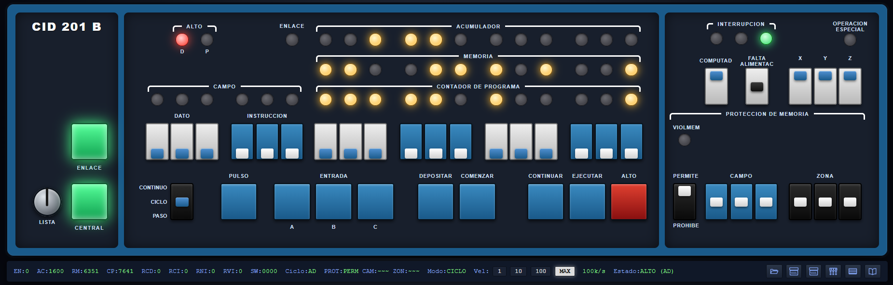
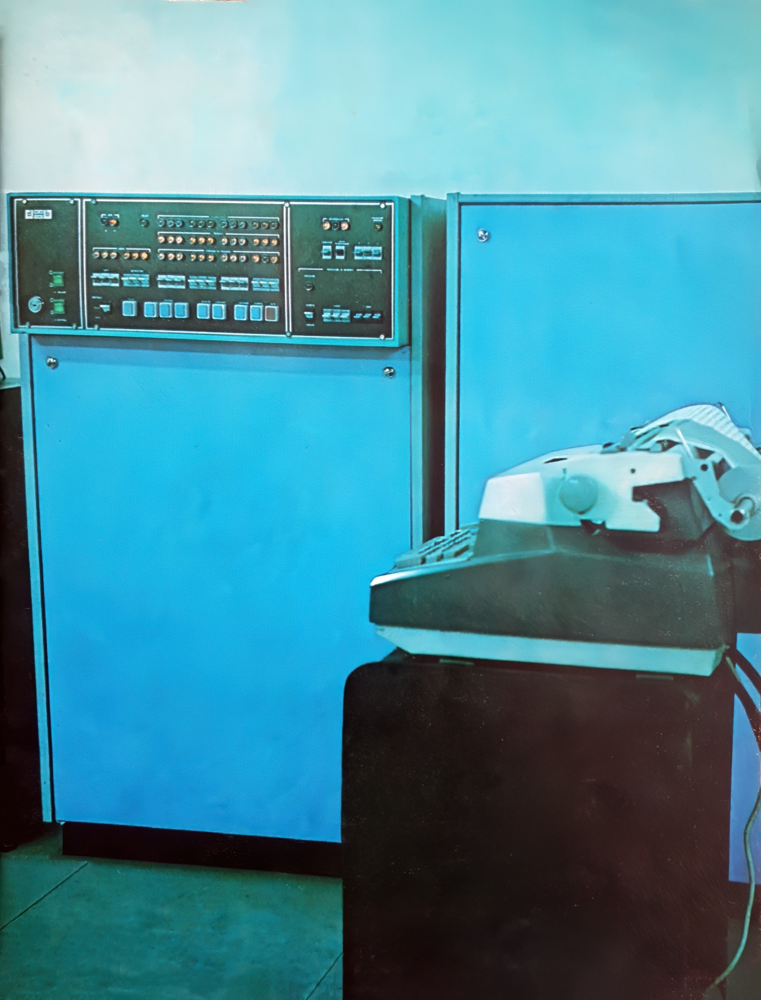

# CIDmulator-B

Simulador funcional, en un único archivo HTML/CSS/JS, de la minicomputadora cubana **CID 201-B** (Centro de Investigación Digital, ICID, Cuba, 1973). Reproduce el segundo modelo, su conjunto de instrucciones LEN, su consola física y sus periféricos: teletipo RICOH-3000 y Consul-260 (teleimpresoras)  y lector y perforador de cinta. Inicia con algunos programas precargados.

**Atención, este es un trabajo en progreso.**

> Un homenaje ejecutable a una de las primeras computadoras diseñadas y fabricadas en América Latina, y a sus creadores.

 # CID 201-B

## Inicio rápido

No requiere instalación ni dependencias. Basta con abrir el archivo `CID201A.html` en un navegador moderno (Chrome, Firefox, Edge, Safari).

O ir a este vínculo: <https://maikelsz.github.io/CIDmulatorCID201B/CIDmulatorCID201B.html>

## Contexto histórico

La **CID 201** fue la primera minicomputadora diseñada y fabricada en Cuba, desarrollada por el **Centro de Investigación Digital (CID)** bajo la dirección de Orlando Ramos. La **CID 201-A** (1971) fue su versión de producción en serie, con la consola integrada en el cuerpo y mejoras de interacción. La CID 201-B fue ya la versión madura, aumentando las capacidades de cómputo, memoria y enlace a periféricos.

| Característica | Valor |
|---|---|
| Tipo | Minicomputadora de 3.ª generación |
| Introducción | 1973 |
| Fabricación | 1973 – 1979 |
| Construidas | ~240 |
| Longitud de palabra | 12 bits |
| Velocidad | 50000 sumas (registro + memoria) por segundo (50 Kops) |
| Memoria | Núcleos de ferrita, hasta 32 Kpalabras × 12 bits |
| Ciclo de memoria | 1,5 µs |
| Tecnología | TTL |
| Software | Ensamblador, LEAL, FOCAL, LINCO, ensamblador ENSIMACC. Variantes de ALGOL 60, COBOL, BASIC, SNOBOL, FORTRAN IV, LEE |
| Sistema operativo | SCP1, SCP2, SN2, SIDOP-201B, Monitor con ensamblador, depurador y editor; monitor en tiempo real. |
